# STRIX — GenAI-Powered APT Detection & Response Platform

> A full-stack security platform that fuses **five deep-learning models** with a **reinforcement-learning agent** to detect Advanced Persistent Threats (APTs) along the Cyber Kill Chain — and responds automatically. Verdicts are surfaced through a production-grade web console (**CAVIX**), a mobile companion app, and a fully reproducible attack-lab built on Wazuh + MITRE Caldera.

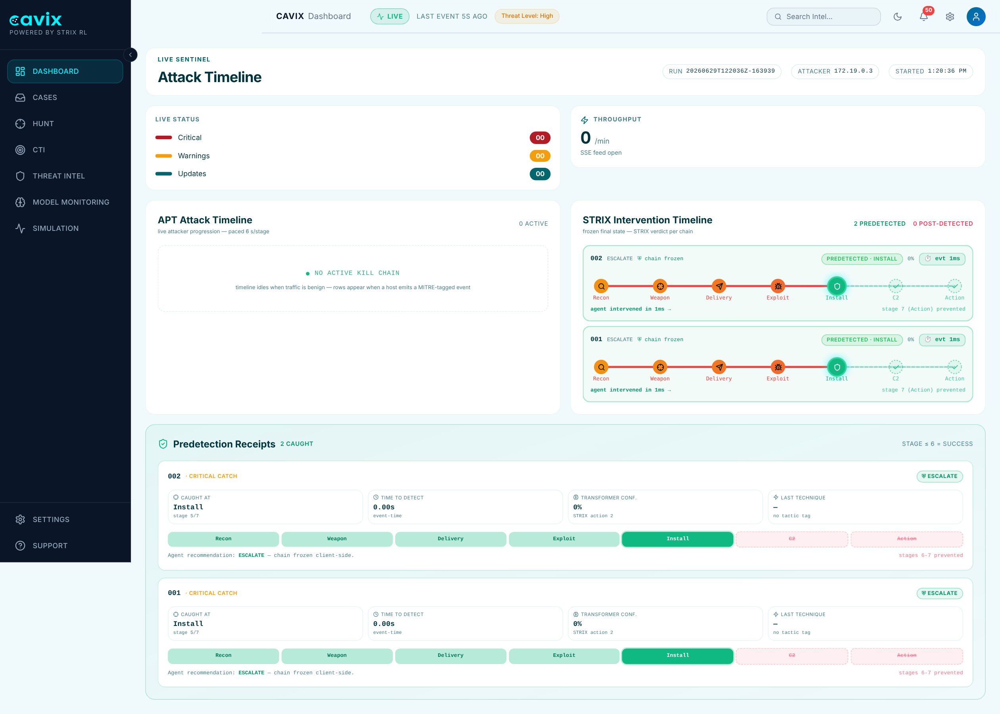

**Stack:** PyTorch · PyTorch Geometric · SecBERT · FastAPI · PostgreSQL (TimescaleDB) · Redis · ARQ · Next.js 14 · React Native (Expo) · Docker Compose · Wazuh · Auditd · Filebeat · Caldera · Prometheus

---

## Table of contents

1. [What is STRIX?](#1-what-is-strix)
2. [Architecture](#2-architecture)
3. [Repository layout](#3-repository-layout)
4. [Prerequisites](#4-prerequisites)
5. [Quick start (one command)](#5-quick-start-one-command)
6. [Building the project](#6-building-the-project)
   - [6.1 Backend API](#61-backend-api-appsapi)
   - [6.2 Web console](#62-web-console-appsweb)
   - [6.3 Mobile app](#63-mobile-app-appsmobile)
   - [6.4 ML models & RL agent](#64-ml-models--rl-agent)
7. [Deployment](#7-deployment)
   - [7.1 Option A — all-Docker platform](#71-option-a--all-docker-platform)
   - [7.2 Option B — host-native lab (recommended for demos)](#72-option-b--host-native-lab-recommended-for-demos)
   - [7.3 Running the attack simulation](#73-running-the-attack-simulation)
   - [7.4 Environment variables](#74-environment-variables)
   - [7.5 Ports reference](#75-ports-reference)
   - [7.6 Verifying the deployment](#76-verifying-the-deployment)
8. [User guide (with screenshots)](#8-user-guide)
   - [8.1 Signing in](#81-signing-in)
   - [8.2 Dashboard](#82-dashboard--live-sentinel)
   - [8.3 Cases — triage queue](#83-cases--triage-queue)
   - [8.4 Attack Analysis — kill-chain deep dive](#84-attack-analysis--kill-chain-deep-dive)
   - [8.5 Hunt — KQL-lite threat hunting](#85-hunt--kql-lite-threat-hunting)
   - [8.6 CTI — threat actors & campaigns](#86-cti--threat-actors--campaigns)
   - [8.7 Threat Intel — IOC reputation & MITRE coverage](#87-threat-intel--ioc-reputation--mitre-coverage)
   - [8.8 Model Monitoring — AI Engine](#88-model-monitoring--ai-engine)
   - [8.9 Simulation — lab topology](#89-simulation--lab-topology)
   - [8.10 Response Actions](#810-response-actions)
   - [8.11 Vigilance Feed & Notifications](#811-vigilance-feed--notifications)
   - [8.12 Host drill-down](#812-host-drill-down)
   - [8.13 Settings, Profile & Support](#813-settings-profile--support)
   - [8.14 Mobile app (CAVIX)](#814-mobile-app-cavix)
9. [Troubleshooting](#9-troubleshooting)
10. [Further documentation](#10-further-documentation)

---

## 1. What is STRIX?

Advanced Persistent Threats unfold over days or weeks across the 8 stages of the Cyber Kill Chain (CKC):

```
Reconnaissance → Weaponization → Delivery → Exploitation → Installation → Command & Control → Lateral Movement → Actions on Objectives
```

Classical signature-based SIEMs detect attacks **after** the damage is done. STRIX targets **early-stage detection** (stages 1–2) and **automated response** by combining:

| Model | Architecture | Role |
|---|---|---|
| **AE** (Autoencoder) | Dense, 55→64 latent, LeakyReLU | Reconstruction-error anomaly score |
| **β-VAE** | [512, 256, 128] → latent 32, β = 0.5 | Calibrated malicious probability + uncertainty |
| **Transformer** | 8-stage CKC next-step predictor | Predicts the attacker's *next* kill-chain stage |
| **GNN** (GraphSAGE) | 3 layers, hidden 128 | Detects lateral-movement propagation across hosts |
| **SecBERT** | Cybersecurity BERT + PCA-16 | Embeds raw log & command-line text into features |
| **DQN agent** | Q-net [128, 64], 5 actions | Learns the response policy |

The five model outputs are fused into a **13-dimensional state vector** consumed by the DQN, which chooses one of five actions: `MONITOR`, `LOW_ALERT`, `ESCALATE`, `ISOLATE_HOST`, `BLOCK_USER_IP`.

> **Safety design:** the DQN is gated behind deterministic ML thresholds. A pure-RL policy was measured to produce 100% false-positive interventions in ablation — the production gates are load-bearing, and destructive actions require human approval in the Response Actions page.

Every model weight is **SHA-256-pinned** in [apps/models/registry.json](apps/models/registry.json); workers refuse to boot on a hash mismatch.

## 2. Architecture

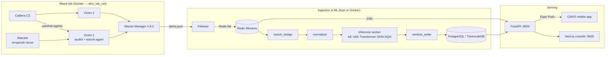

The full path proven by the demo: **Caldera → Wazuh → Filebeat → Redis → normalizer → 5-model inference → DQN decision → Postgres → web/mobile in real time.**

## 3. Repository layout

```
GenAI-Detection-Framework/
├── apps/
│   ├── api/          # FastAPI backend (strix_api), ARQ workers, Alembic migrations
│   ├── web/          # Next.js 14 analyst console (pnpm)
│   ├── mobile/       # React Native (Expo) companion app "CAVIX" (npm)
│   ├── models/       # Hash-pinned model weights + registry.json + preprocessing artifacts
│   ├── notebooks/    # Model-training notebooks (AE, VAE, GNN, Transformer)
│   └── data/         # Training dataset
├── RL_agent/         # Standalone DQN training project (env, train, evaluate, ablation)
├── infra/
│   ├── compose.*.yml         # Docker stacks: api, platform-deps, simulation, chaos…
│   ├── lab-provisioning/     # Wazuh rules & multi-host provisioners
│   ├── simulation/           # Caldera orchestrator, victim/attacker images, benign traffic
│   ├── scripts/              # lab_up, lab_simulate, smoke tests, calibration, seeding…
│   └── loadtests/            # k6 load tests
├── docs/             # Architecture, runbooks, lab guides, demo scripts, screenshots
├── config/           # Wazuh config fragments
├── Makefile          # Canonical entry points (make help)
├── Procfile.host     # honcho process file: api + 7 workers + web
└── jury_demo.sh      # One-shot end-to-end demo (attack → detection → response)
```

## 4. Prerequisites

| Tool | Version | Used for |
|---|---|---|
| **Docker + Compose v2** | recent | Postgres, Redis, Wazuh, Caldera, victims, Filebeat |
| **Python** | ≥ 3.11, < 3.13 | API, workers, ML, scripts |
| **Node.js** | 20.x | Web console & mobile app |
| **pnpm** | via `corepack enable` | Web console package manager |
| **honcho** | `pipx install honcho` | Runs the host-native process group (`Procfile.host`) |
| *(optional)* **EAS CLI** | ≥ 16 | Mobile dev-client builds |
| *(optional)* **uv** | latest | Faster Python installs |

Hardware: the whole stack (lab + platform) runs on a single Linux machine; 16 GB RAM recommended. Torch is pinned **CPU-only** in the API image — no GPU required at inference time.

## 5. Quick start (one command)

The fastest way to see everything working — full stack bring-up, a real Caldera-driven APT emulation against two victims, live detection and an RL intervention on the dashboard:

```bash
# one-time setup (see §6.1 & §6.2 for details)
make env                       # create apps/api/.env — set DB_PASSWORD & AUTH_JWT_SECRET
cd apps/api && python3 -m venv .venv && .venv/bin/pip install -e ".[dev]" && cd ../..
cd apps/web && pnpm install && cd ../..
pipx install honcho

# the headline demo
bash jury_demo.sh --non-monotonic

# first run only: create your operator account (jury_demo.sh does not seed users)
make host-seed ADMIN_EMAIL=admin@strix.io ADMIN_PASSWORD='changeme123!'
```

Then open **http://localhost:5600** and log in (`admin@strix.io` / `changeme123!`). The dashboard lights up as the attack progresses; the DQN escalates/isolates before the chain reaches *Actions on Objectives*.

> Use a routable-style email for the admin — the API's validation rejects reserved TLDs, so `admin@strix.local` (the Makefile's historical default) **cannot log in**. `admin@strix.io` works.

```bash
bash jury_demo.sh stop         # tear everything down
```

## 6. Building the project

The repo is **not** a unified workspace — each app builds independently with its own package manager (API → pip, web → pnpm, mobile → npm).

### 6.1 Backend API (`apps/api`)

FastAPI service (`strix_api`) + 7 worker processes, packaged with hatchling.

```bash
cd apps/api

# 1. virtualenv + install (dev extras: ruff, mypy, pytest, hypothesis, respx, …)
python3 -m venv .venv
source .venv/bin/activate
pip install -e ".[dev]"        # or: uv pip install -e ".[dev]"

# 2. configuration
cp .env.example .env           # from repo root: make env
#    → edit: DB_PASSWORD (required) and AUTH_JWT_SECRET (required outside dev)
#    → for host-native runs: DB_HOST=localhost DB_PORT=5435 REDIS_HOST=localhost REDIS_PORT=6380

# 3. database migrations (Postgres must be up — see §7)
alembic upgrade head

# 4. run the API
uvicorn strix_api.main:app --host 0.0.0.0 --port 8000
```

Interactive API docs: **http://localhost:8000/api/v1/docs**

**Workers** are separate entry points (all started for you by `Procfile.host` / the compose `workers` profile):

```bash
python -m strix_api.workers.wazuh_bridge      # Redis list → Redis Stream
python -m strix_api.workers.normalizer        # raw Wazuh alert → canonical event
python -m strix_api.workers.inference         # AE/VAE/Transformer/GNN/DQN scoring (INFERENCE_SHARD_ID / INFERENCE_NUM_SHARDS)
python -m strix_api.workers.verdicts_writer   # verdicts → Postgres
python -m strix_api.workers.demo_isolation    # applies approved isolation actions in the lab
python -m strix_api.workers.intel_feeds_worker
arq strix_api.workers.arq_tasks.WorkerSettings
```

**Tests**

```bash
pytest                          # unit tests
pytest -m integration           # integration (spins up real Postgres + Redis via testcontainers)
pytest --cov=strix_api --cov-report=term-missing
# or from repo root:
make test
```

**Docker image:** [apps/api/Dockerfile](apps/api/Dockerfile) — two-stage build, CPU-only `torch==2.4.1+cpu` (avoids ~3 GB of CUDA), runs as non-root, exposes `:8000`. Built automatically by `make up` / `make workers`.

### 6.2 Web console (`apps/web`)

Next.js 14 (App Router) + React 18 + Zustand + TanStack Query + Tailwind + Recharts + ReactFlow. Package manager is **pnpm**.

```bash
corepack enable                # once, to get pnpm
cd apps/web
pnpm install

pnpm dev                       # dev server → http://localhost:3000  (demo stack uses PORT=5600)
pnpm build                     # production build
pnpm start                     # serve the production build
pnpm lint
```

The console never talks to FastAPI cross-origin: [next.config.js](apps/web/next.config.js) rewrites `/api/v1/*` to `STRIX_API_URL` (default `http://localhost:8000`) so httpOnly auth cookies stay same-origin.

**Type-safe API layer** — TypeScript types are generated from the FastAPI OpenAPI spec:

```bash
pnpm gen:api-types             # from a live API at :8000
pnpm gen:api-types:offline     # from the committed lib/openapi.json
pnpm check:api-types           # CI drift check
make openapi                   # (repo root) regenerate lib/openapi.json from the code
```

**Docker image:** [apps/web/Dockerfile](apps/web/Dockerfile) — node:20 + corepack, `pnpm build` → `pnpm start` on `:3000`.

### 6.3 Mobile app (`apps/mobile`)

React Native (Expo SDK 54, expo-router, dev-client) — brand name **CAVIX**. Package manager is **npm**.

```bash
cd apps/mobile
npm install

# point the app at your API — use your LAN IP, not localhost, for a physical phone
EXPO_PUBLIC_API_URL="http://<LAN_IP>:8000" npx expo start --clear
# fallbacks: --tunnel (restrictive networks) · --dev-client (custom dev build)
```

Push notifications use **Expo Push** (not bare FCM) and require a dev-client build:

```bash
npm i -g eas-cli
eas build --profile development --platform android    # profiles in eas.json (Node 20.18.0 pinned)
```

See [docs/mobile/MOBILE_DEVICE_SETUP.md](docs/mobile/MOBILE_DEVICE_SETUP.md) and [docs/mobile/MOBILE_DEV_BUILD.md](docs/mobile/MOBILE_DEV_BUILD.md) for device pairing and build details.

### 6.4 ML models & RL agent

**You do not need to train anything to run the platform** — trained weights ship in [apps/models/](apps/models/) and are verified against `registry.json` (SHA-256) at worker startup.

**Retraining the DQN** (standalone project):

```bash
cd RL_agent
python3 -m venv .venv && source .venv/bin/activate
pip install -r requirements.txt

python train.py --num_episodes 3000 --device cpu --output_dir ./outputs
python evaluate_real.py         # evaluation on real lab sequences
python ablation_study.py        # incl. the pure-RL-vs-gated comparison
python evaluate_scaling.py
```

Copy the resulting `rl_agent.pth` into `apps/models/` and update its hash in `registry.json`.

**Recalibrating the VAE on your lab's distribution** (drift handling):

```bash
python infra/scripts/calibration_label_jsonl.py     # label alerts
python infra/scripts/calibration_label_audit.py     # audit labels
python infra/scripts/calibration_refit.py           # fit new calibrator → patches probability_calibrators.pkl
```

The refit writes a new calibrator key (`Beta-VAE (Top 25) lab-refit`) but does **not** auto-activate it — an operator switches the active key in the registry deliberately.

Training notebooks for the AE/VAE/GNN/Transformer live in [apps/notebooks/](apps/notebooks/).

## 7. Deployment

Two supported topologies. Both share the same `.env` ([§7.4](#74-environment-variables)).

### 7.1 Option A — all-Docker platform

Everything (Postgres, Redis, API, workers, queue) in containers via [infra/compose.api.yml](infra/compose.api.yml):

```bash
make env          # create apps/api/.env — set DB_PASSWORD (+ AUTH_JWT_SECRET)
make workers      # postgres + redis + api + migrate + all workers + arq   (make up = api only)
make migrate      # alembic upgrade head (also run automatically by the migrate service)
make seed ADMIN_EMAIL=admin@strix.io ADMIN_PASSWORD='changeme123!'   # bootstrap admin (avoid .local emails — see §9)
make obs          # optional: Prometheus → http://localhost:9091

# web console runs on the host:
cd apps/web && pnpm install && pnpm dev        # → http://localhost:3000
```

Useful ops targets: `make logs`, `make ps`, `make restart`, `make down` (keep volumes), `make nuke` (**drops volumes — data loss**).

### 7.2 Option B — host-native lab (recommended for demos)

Simulation + infra deps in Docker; the platform itself (API + workers + web) runs natively on the host via honcho. This is the topology `jury_demo.sh` uses.

```bash
# 0. one-time: build the Caldera image (not on a registry) — see docs/lab/LAB_BRINGUP.md
# 1. full bring-up: simulation + deps + migrate + seed
make lab-up       # = sim-up + deps-up + host-migrate + host-seed
# 2. start the platform processes (api + 7 workers + web on :5600)
make host-up      # honcho -f Procfile.host -e apps/api/.env start
# 3. verify the 8 connectivity probes
make lab-verify
```

Individual pieces, if you prefer granular control:

```bash
make sim-up       # Wazuh manager + Caldera + victim1 + victim2 + attacker   (compose.simulation.yml)
make deps-up      # Postgres :5435 + Redis :6380 + Filebeat                  (compose.platform-deps.yml)
make host-migrate # alembic upgrade head against localhost:5435
make host-seed ADMIN_EMAIL=admin@strix.io ADMIN_PASSWORD='changeme123!'      # seed admin user
make sim-down · make deps-down                 # teardown
```

Or the single wrapper: `bash infra/scripts/lab_up.sh` (add `stop` to tear down, `--no-verify` to skip probes).

### 7.3 Running the attack simulation

With the lab up, drive Caldera through real MITRE ATT&CK tactics against the victims:

```bash
# the full end-to-end demo (bring-up + attack + live dashboard), the headline path:
bash jury_demo.sh --non-monotonic        # curated kill-chain that visibly trips the DQN's ESCALATE
bash jury_demo.sh --apt APT41            # alternative APT profile (default APT29)
bash jury_demo.sh --duration 240 --benign-rate 300/min
bash jury_demo.sh --keep-state           # don't wipe DB/Redis state from previous runs
bash jury_demo.sh --skip-sim             # platform only, no attack
bash jury_demo.sh stop                   # full teardown
bash jury_demo_single.sh                 # single-victim variant (cleaner narrative)

# lower-level simulation driver (all 9 paper tactics, per-tactic + final report):
bash infra/scripts/lab_simulate.sh
bash infra/scripts/lab_simulate.sh --list            # list tactics
bash infra/scripts/lab_simulate.sh --only T1595      # run one tactic
bash infra/scripts/lab_simulate.sh --dry-run
bash infra/scripts/lab_simulate.sh --non-monotonic --apt APT29

# force a live ESCALATE (populates Notifications + mobile push) without a full run:
python infra/scripts/escalate_demo.py
```

Benign background traffic (~300 events/min per victim by default) runs alongside the attack so detection happens in realistic noise.

### 7.4 Environment variables

All API settings live in `apps/api/.env` (template: [apps/api/.env.example](apps/api/.env.example)), grouped by prefix:

| Prefix | Key variables | Notes |
|---|---|---|
| core | `ENV` (dev/staging/prod), `SERVICE_NAME` | |
| `DB_*` | `DB_HOST DB_PORT DB_NAME DB_USER` **`DB_PASSWORD`** | password **required** — process refuses to boot without it. Docker: `postgres:5432` · host-native: `localhost:5435` |
| `REDIS_*` | `REDIS_HOST REDIS_PORT REDIS_DB REDIS_PASSWORD` | Docker: `redis:6379` · host-native: `localhost:6380` |
| `MODELS_*` | `MODELS_PATH`, `MODELS_VERIFY_CHECKSUMS=true` | SHA-256 verification of every weight at startup |
| `AUTH_*` | **`AUTH_JWT_SECRET`**, `AUTH_DEV_SKIP_AUTH`, `AUTH_JWT_ACCESS_TTL_MINUTES`, `AUTH_JWT_REFRESH_TTL_DAYS`, `AUTH_AUTO_RESPONSE_ENABLED=false` | JWT secret required outside dev; dev bypass only honoured when `ENV=dev`; auto-response hard-off by default |
| `WAZUH_*` | `WAZUH_RAW_STREAM`, `WAZUH_CONSUMER_GROUP` | Redis stream names for ingestion |
| `INFERENCE_*` | `INFERENCE_NUM_SHARDS`, `INFERENCE_SHARD_ID`, `INFERENCE_AE_BATCH_MAX` | worker sharding & batching |
| `LLM_*` | `LLM_ANTHROPIC_API_KEY` (optional), `LLM_SENTINEL_MODEL`, `LLM_LIVEFEED_MODEL` | GenAI case summaries / live-feed enrichment — platform runs fine without a key |
| `THREAT_INTEL_*` | VirusTotal key (optional), circuit-breaker tuning | |
| `OBS_*` | `OBS_LOG_LEVEL`, `OBS_LOG_JSON`, `OBS_METRICS_PORT`, `OBS_TRACING_ENABLED` | structlog + Prometheus + OTLP |

Web: `STRIX_API_URL` (proxy target, default `http://localhost:8000`), `PORT`.
Mobile: `EXPO_PUBLIC_API_URL`.

### 7.5 Ports reference

| Service | Port | Notes |
|---|---|---|
| Web console | **5600** (honcho/demo) or **3000** (standalone `pnpm dev`) | |
| FastAPI | **8000** | docs at `/api/v1/docs` |
| PostgreSQL (TimescaleDB) | **5435** → 5432 | host-native binds 127.0.0.1 only |
| Redis | **6380** → 6379 | |
| Prometheus | **9091** → 9090 | `make obs` profile |
| Wazuh manager | **1514**, 1514/udp, **1515**, **55000** | agent enrolment + API |
| Caldera | **8888** | red/blue consoles |

### 7.6 Verifying the deployment

```bash
make smoke         # full pipeline proof: inject alert → Redis → normalizer → inference → Postgres + SSE
make smoke-fast    # same, assumes stack already up + admin seeded
make smoke-mobile  # mobile contract: register → Bearer → SSE → logout
make lab-verify    # 8 lab connectivity probes

# browser-level end-to-end check (drives the real UI with Playwright):
python infra/scripts/playwright_check.py
```

## 8. User guide

The console (brand name **CAVIX**, "powered by STRIX RL") is a SOC workbench with light and dark themes (moon toggle in the top bar). The left sidebar is the primary navigation:

**DASHBOARD** · **CASES** · **HUNT** · **CTI** · **THREAT INTEL** · **MODEL MONITORING** · **SIMULATION** — plus **SETTINGS** and **SUPPORT** at the bottom. The top bar carries the live-connection indicator, global threat level, search, the notification bell, and your operator badge.

A typical analyst workflow: watch the **Dashboard** → triage in **Cases** → deep-dive a chain in **Attack Analysis** → pivot into **Hunt** for evidence → approve/decline the DQN's proposals in **Response Actions**.

### Built-in interactive tutorial

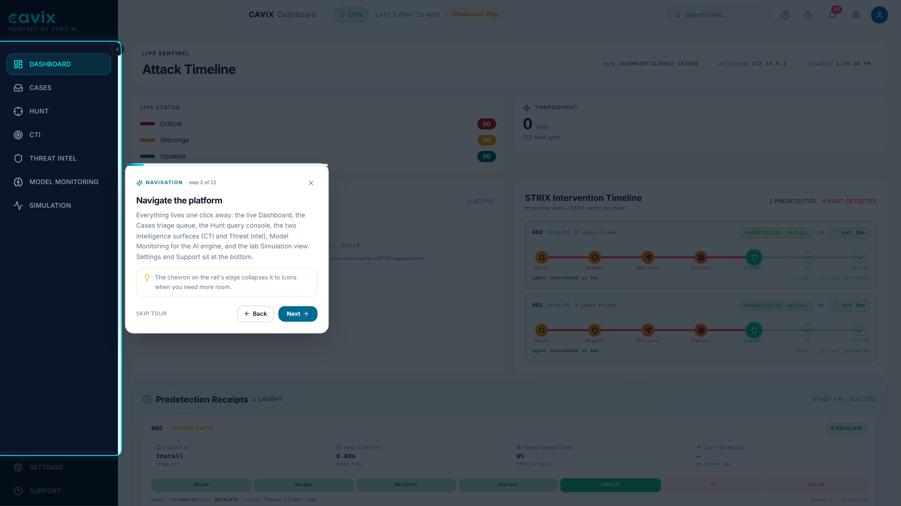

The console ships with a **22-step guided tour** that spotlights every major component in place, explains what it shows and how to interact with it, and navigates between pages by itself. It starts automatically the first time a new operator lands on the dashboard, and can be relaunched anytime from the **`?` icon in the top bar** or the **"Launch interactive tutorial"** button on the Support page. Navigate with the **Next / Back** buttons or the **→ / ←** arrow keys; **Esc** exits, and completion is remembered per browser.

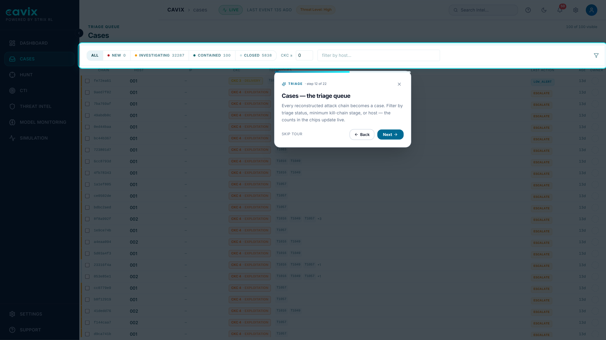

### 8.1 Signing in

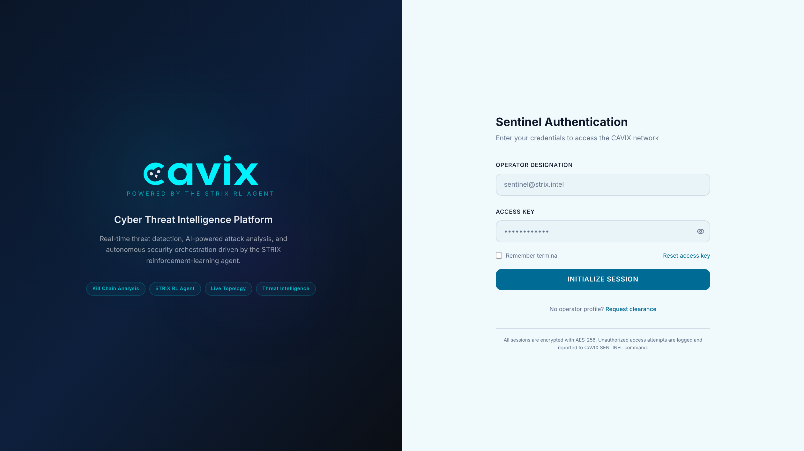

Browse to the console (`http://localhost:5600` in the demo topology) — unauthenticated visitors are redirected to `/login`. Sign in with the admin account you seeded (`make seed` / `make host-seed` with `ADMIN_EMAIL` / `ADMIN_PASSWORD`; use a routable-style email such as `admin@strix.io` — `.local` addresses fail validation). New operators can self-register via **Request clearance**; accounts get the `analyst` role. Sessions are httpOnly-cookie JWTs (15-min access / 7-day refresh, argon2 password hashing).

### 8.2 Dashboard — Live Sentinel


The landing page is the live overview of the current simulation run:

- **Attack Timeline banner** — run metadata: run ID, emulated APT group, attacker IP, start time.
- **APT Attack Timeline** — events placed on the kill-chain as they arrive.
- **RL Kill Chain** — the 8 CKC stages with the DQN's interventions overlaid, showing *where* in the chain the agent acted.
- **Pre-detection receipt** — the headline metric: proof the platform intervened **before** the chain reached *Actions on Objectives*.
- **Live status / throughput KPIs** — ingest rate and pipeline health via SSE.

### 8.3 Cases — triage queue

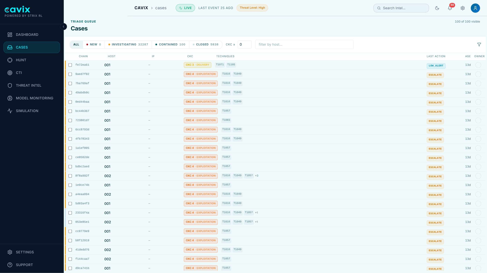

The SOC triage queue: one row per reconstructed **attack chain**. Dense table with severity/status rail, sticky filters (status, minimum CKC stage, host), and a bulk-action bar. Rows flash live via SSE as chains progress (15-second poll backstop). Set triage status per case (open / investigating / closed) and click any row to open the full **Attack Analysis** view.

### 8.4 Attack Analysis — kill-chain deep dive

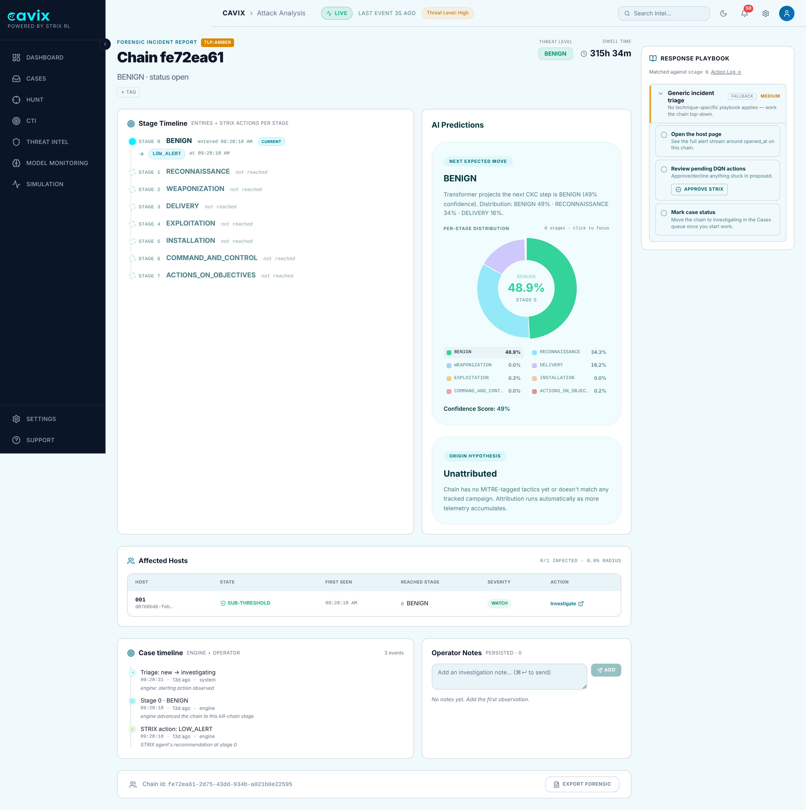

The "money page" — everything known about one attack chain:

- **Chain stage timeline** — the 8 CKC stages with per-stage alert evidence.
- **Affected hosts** table — pivot to any host's drill-down.
- **AI predictions panel** — the Transformer's next-stage probability donut: *what the attacker is expected to do next*.
- **STRIX decisions** — every DQN verdict on this chain with its state vector context.
- **Analyst workspace** — immutable audit notes, tags, TLP marking, playbook viewer, JSON export.

The page live-refreshes while the chain is active.

### 8.5 Hunt — KQL-lite threat hunting

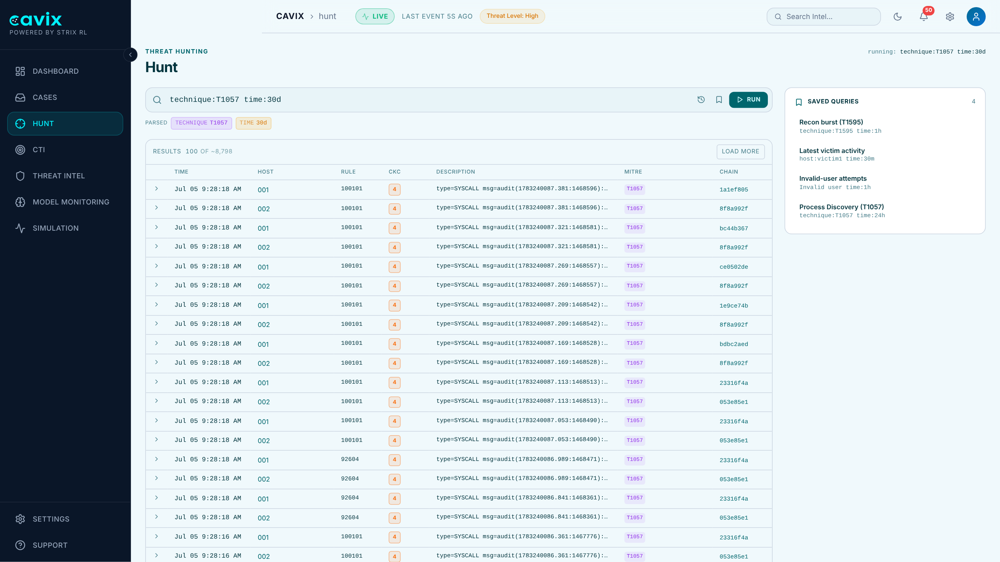

Analyst-driven query bar over all ingested events. Field operators: `host:`, `user:`, `technique:`, `time:` (`30m`, `1h`, `24h`, `7d`, or ISO timestamps), plus free-text (ILIKE). Parsing is permissive — a malformed query never errors, it degrades to free-text. Queries can be saved, and MITRE technique cells elsewhere in the app deep-link here (`/hunt?q=technique:T1595`). The screenshot shows `technique:T1057 time:30d` matching ~8,700 process-discovery events from a demo run. Ready-made queries for the demo attack are collected in [HUNT_DEMO.md](HUNT_DEMO.md).

### 8.6 CTI — threat actors & campaigns

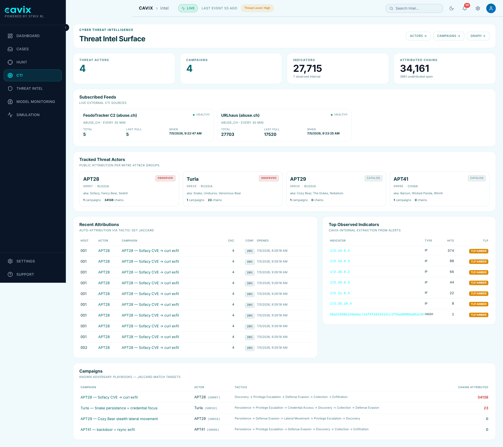

Cyber-threat-intelligence landing: KPI strip (actors / campaigns / indicators / attributed chains), threat-actor cards, recent **chain → actor → campaign** attributions with confidence, and top observed indicators. Drill into actor and campaign detail pages, or open the radial **pivot graph** (actors → campaigns → chains):

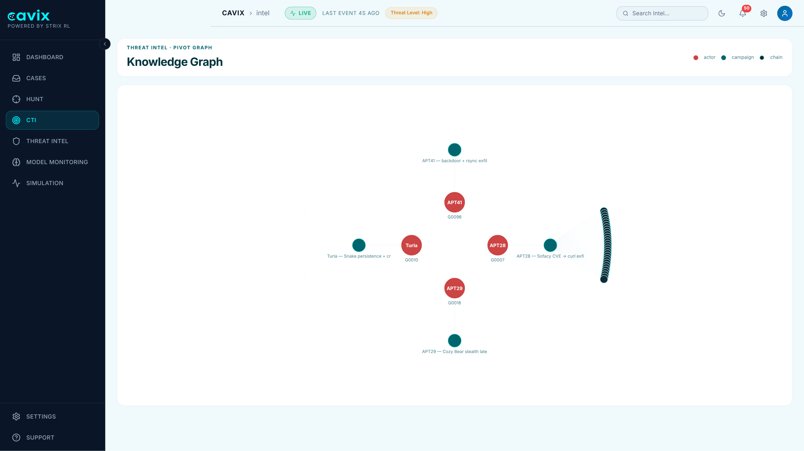

### 8.7 Threat Intel — IOC reputation & MITRE coverage

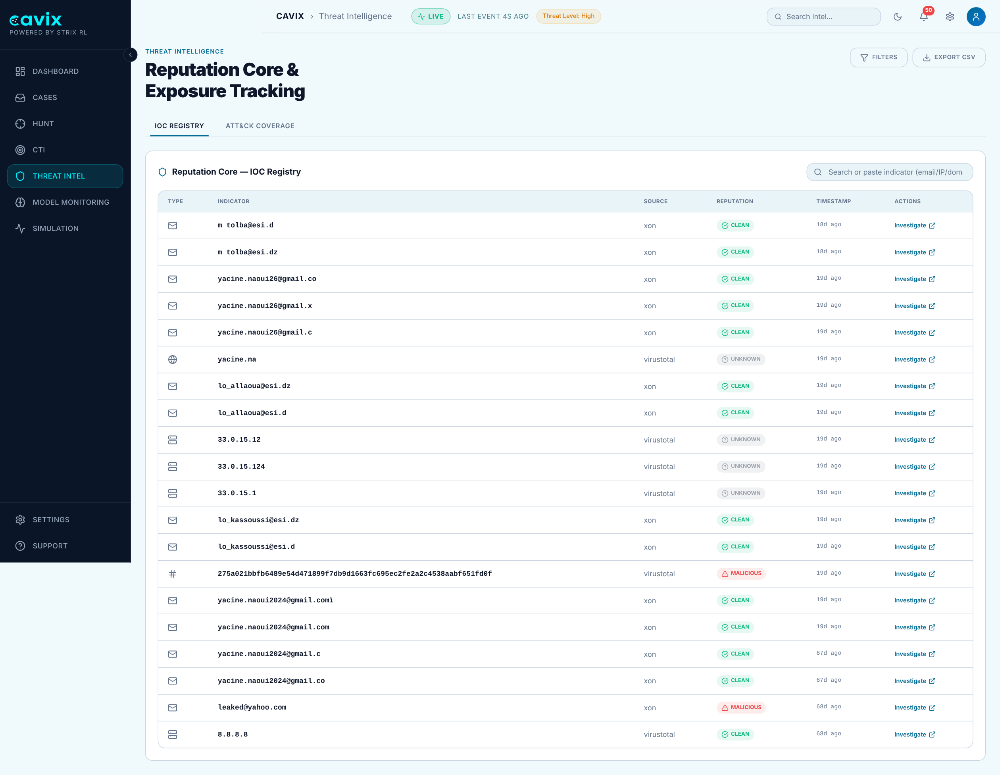

IOC search and reputation (malicious / suspicious / clean / unknown, VirusTotal-backed when a key is configured), the **MITRE ATT&CK coverage matrix** of observed techniques, an observable drawer for quick pivots, and CSV export.

### 8.8 Model Monitoring — AI Engine

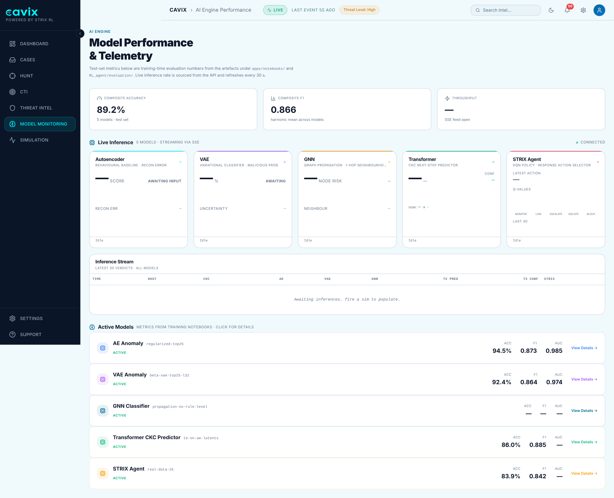

Live health of the ML ensemble:

- **KPI strip** — composite accuracy/F1 and live inference throughput.
- **Five model panels** (AE, VAE, GNN, Transformer, DQN) — live scores, latency, drift telemetry (KL divergence on the VAE).
- **Inference stream** — per-event table: each event's five model scores and the DQN action chosen.

This is where model drift shows up first — see the [model-drift runbook](docs/runbooks/model-drift.md) and the recalibration flow in [§6.4](#64-ml-models--rl-agent).

### 8.9 Simulation — lab topology

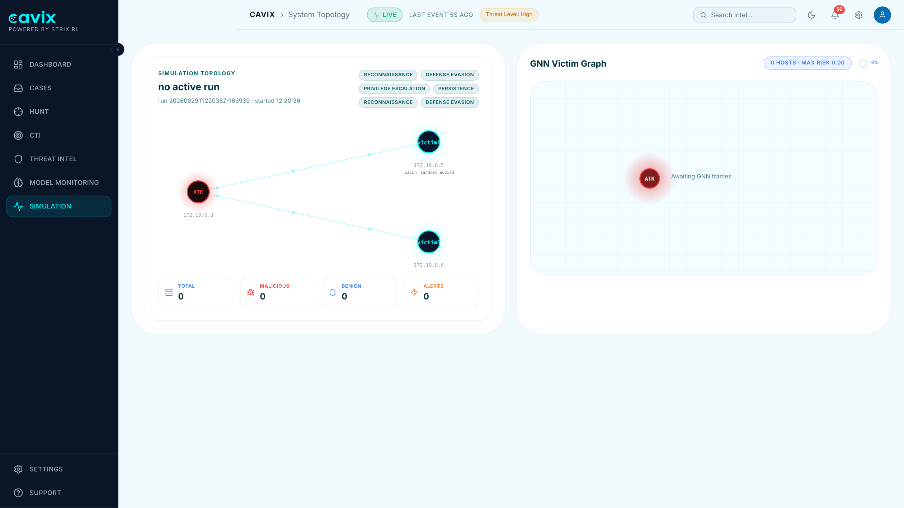

The lab at a glance: attacker → victims → Wazuh topology for the active run, plus the **GNN graph evolution** panel showing how the model's view of host-to-host propagation grows as the attack spreads.

### 8.10 Response Actions

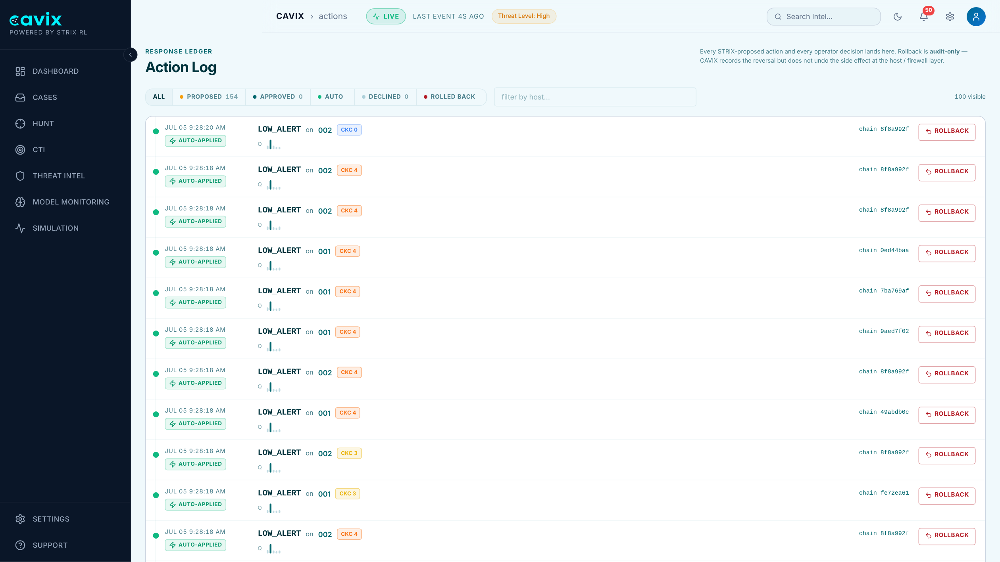

The audit log of every response the DQN proposed and what happened to it — a vertical timeline filterable by status (**proposed / approved / auto_applied / declined / rolled_back**), time window and host. Each row shows the action's Q-value context. Destructive actions (`ISOLATE_HOST`, `BLOCK_USER_IP`) arrive as **proposals** requiring operator approval; rollback demands typing the host name to confirm. Automatic response is hard-off by default (`AUTH_AUTO_RESPONSE_ENABLED=false`).

### 8.11 Vigilance Feed & Notifications

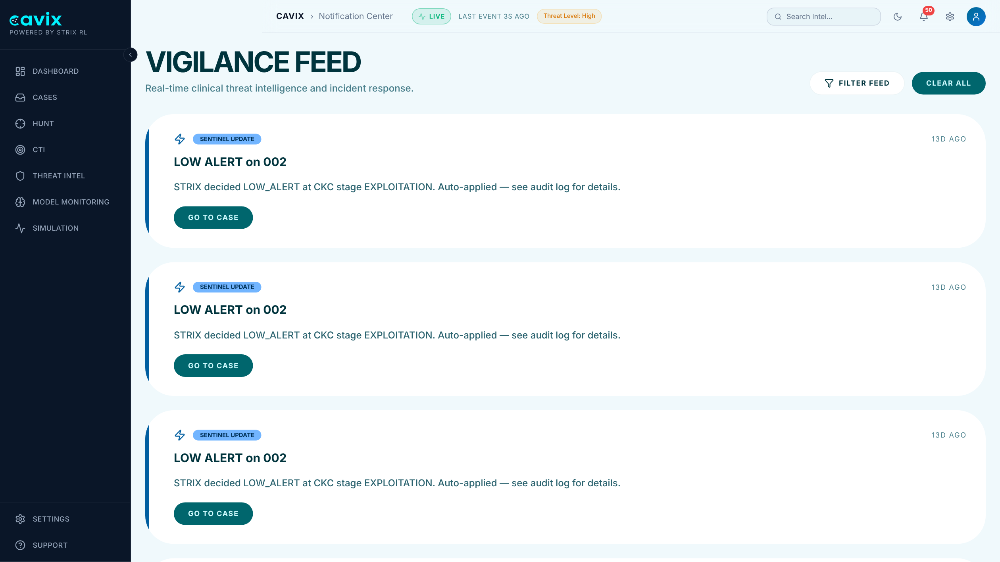

**Notifications** (screenshot) — intervention alerts (ISOLATE/BLOCK → critical, ESCALATE → warning) with a *Go to case* pivot for each. Also surfaced in the top-bar bell drawer, and pushed to the mobile app.

**Vigilance Feed** (`/vigilance-feed`) — the raw live event stream over SSE, severity derived from CKC stage, with filters and report export. It only populates while a simulation or real traffic is flowing, which makes it a good wall display during an active incident.

### 8.12 Host drill-down

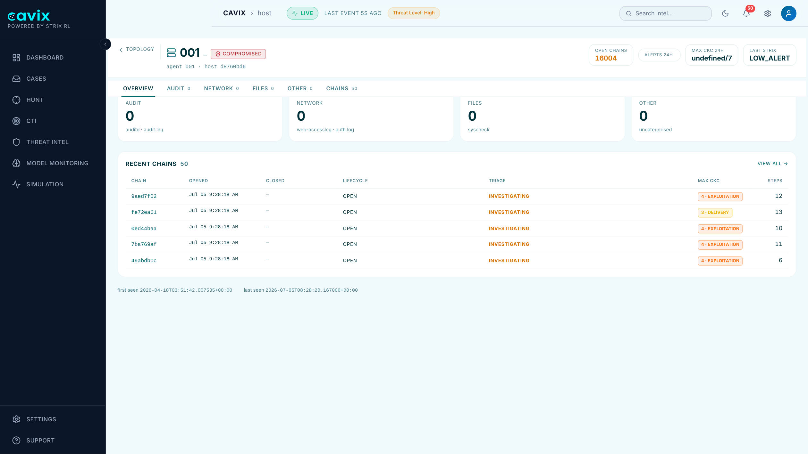

Per-host investigation page: summary tiles, then tabs — **Overview**, **Audit**, **Network**, **Files**, **Other**, **Chains** — with alert tables grouped by decoder family and every chain the host participates in.

### 8.13 Settings, Profile & Support

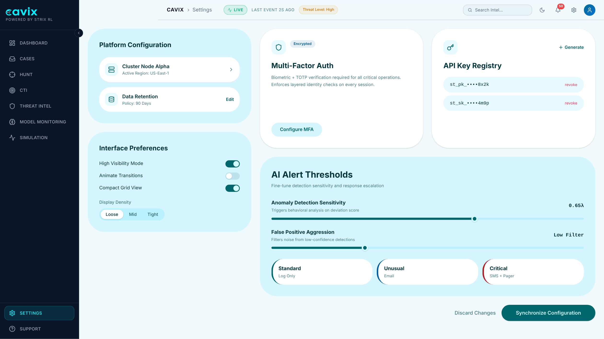

- **Settings** — client-side preferences (persisted locally): animations, grid density, anomaly sensitivity, false-positive aggression, retention window, API keys.
- **Profile** — operator identity and editable display overrides.
- **Support** — incident-report form (level, subject, description) and FAQ.

### 8.14 Mobile app (CAVIX)

The Expo companion app mirrors the console for on-call analysts: onboarding, login, a dashboard with live alert counters and kill-chain progress, cases, response actions, live feed, search, and **push notifications on DQN interventions** (Expo Push). Run it against your API with:

```bash
cd apps/mobile && EXPO_PUBLIC_API_URL="http://<LAN_IP>:8000" npx expo start --clear
```

Trigger a real push during a demo with `python infra/scripts/escalate_demo.py`.

## 9. Troubleshooting

| Symptom | Cause / fix |
|---|---|
| Lab produces **zero chains** after a host reboot | auditd rules are not persistent — run `sudo augenrules --load` on the host, then re-run the simulation |
| API exits immediately at boot | `DB_PASSWORD` missing in `apps/api/.env` (it is required), or Postgres not reachable on `localhost:5435` |
| Workers refuse to start with a checksum error | model weight ≠ `registry.json` hash — restore the weight or update the hash deliberately (see [runbook](docs/runbooks/model-loaded-wrong-weights.md)) |
| `caldera:latest not found` on `make sim-up` | the Caldera image must be built locally once — see [docs/lab/LAB_BRINGUP.md](docs/lab/LAB_BRINGUP.md) |
| Login returns a validation error | the admin was seeded with a reserved-TLD email — `admin@strix.local` is rejected by the API's email validation. Re-seed with e.g. `admin@strix.io` |
| Web console empty / login loops | seed the admin (`make seed` / `make host-seed`); check the API is on `:8000` and `STRIX_API_URL` matches |
| Redis OOM / backlog during long runs | Redis runs `noeviction` by design — see [redis-backlog runbook](docs/runbooks/redis-backlog.md) |
| Phone app can't reach the API | use the LAN IP in `EXPO_PUBLIC_API_URL` (not `localhost`); same Wi-Fi; fallback `npx expo start --tunnel` |
| Demo shows stale data | `jury_demo.sh` wipes state by default (`CLEAN_STATE=1`); pass `--keep-state` to keep history — or check `/tmp/strix_honcho.log` for process errors |
| Port already in use | check the [ports table](#75-ports-reference) — 5435/6380 were chosen to avoid clashing with system Postgres/Redis |

More: [docs/runbooks/](docs/runbooks/) covers inference-worker OOM, slow inference, Postgres tuning, external-API outages, kill-switch operation, and secret rotation.

## 10. Further documentation

| Document | Contents |
|---|---|
| [docs/architectures/ARCHITECTURE.md](docs/architectures/ARCHITECTURE.md) | Full system architecture |
| [docs/architectures/MODELS_REFERENCE.md](docs/architectures/MODELS_REFERENCE.md) | Model specs & feature schema |
| [docs/architectures/INGESTION_PIPELINE.md](docs/architectures/INGESTION_PIPELINE.md) | Wazuh → Redis → workers pipeline |
| [docs/lab/LAB_BRINGUP.md](docs/lab/LAB_BRINGUP.md) | Copy-paste lab runbook (Wazuh + Caldera + victims) |
| [docs/lab/CALDERA_PLAYBOOK.md](docs/lab/CALDERA_PLAYBOOK.md) | Driving Caldera operations |
| [docs/demo/JURY_DEMO_SCRIPT.md](docs/demo/JURY_DEMO_SCRIPT.md) | Full 25-minute presentation walkthrough |
| [docs/demo/PLATFORM_BRIEFING.md](docs/demo/PLATFORM_BRIEFING.md) | Conceptual briefing: what CAVIX is and honest limitations |
| [DEMO_COMMANDS.md](DEMO_COMMANDS.md) | Demo cheat-sheet |
| [HUNT_DEMO.md](HUNT_DEMO.md) | Ready-made Hunt queries |
| [docs/web/WEB_RUN.md](docs/web/WEB_RUN.md) | Web + API dev-run notes |
| [docs/runbooks/](docs/runbooks/) | Operational runbooks |
| [apps/api/README.md](apps/api/README.md) | API-specific quickstart |
| [RL_agent/README.md](RL_agent/README.md) | DQN training project |

---

*STRIX is a thesis (PFE) project — an end-to-end demonstration that GenAI-era ML can detect and respond to APTs earlier than signature-based SIEMs, built and operated by a single engineer across ML, backend, web, mobile, and infrastructure.*
